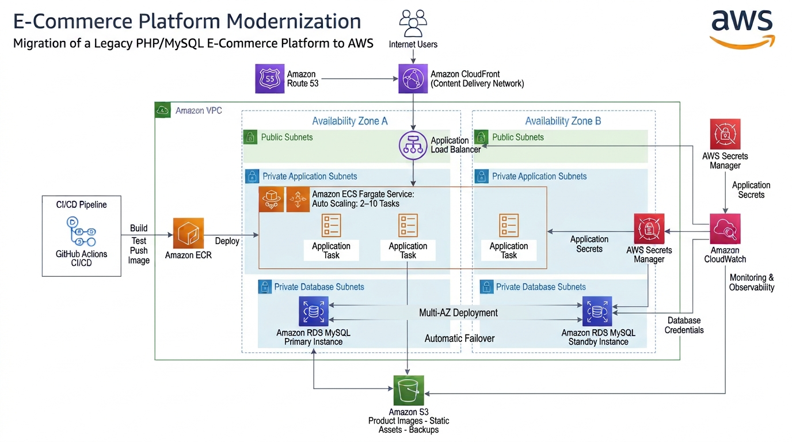
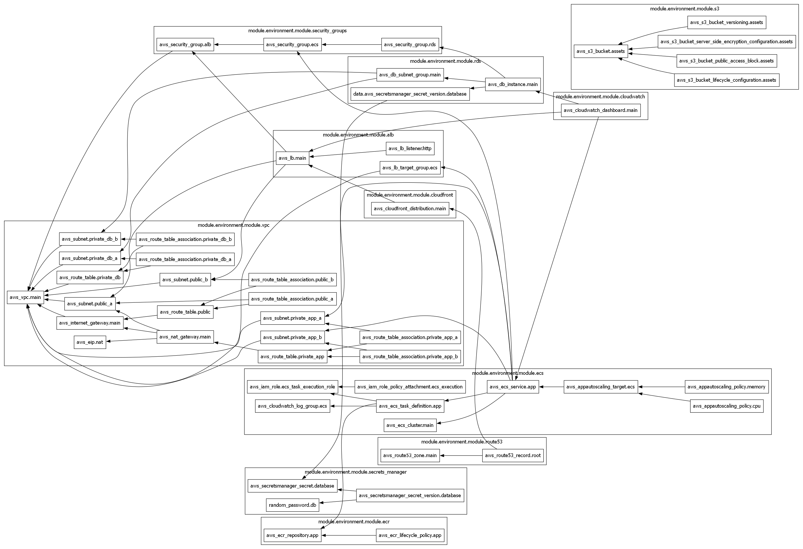
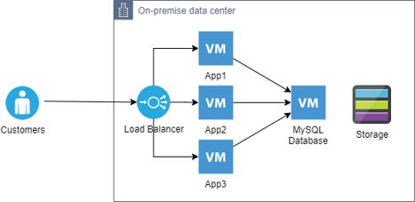
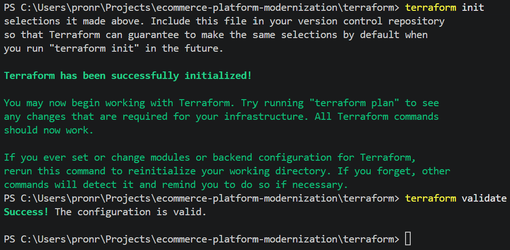

# E-Commerce Platform Modernization

## Overview

This project demonstrates the modernization of a legacy PHP/MySQL e-commerce platform from a traditional on-premises infrastructure to Amazon Web Services (AWS).

The objective is to improve scalability, availability, security, operational efficiency, observability, and deployment automation through cloud-native services, Infrastructure as Code (IaC), containerization, and CI/CD practices.

The project follows a realistic migration journey, beginning with a simulated on-premises environment and progressing to a production-oriented AWS architecture.

---

# AWS Target Architecture

The following diagram illustrates the target cloud architecture.



## Terraform Infrastructure Dependency Graph

The Infrastructure as Code implementation was validated using Terraform dependency analysis.

The graph below illustrates relationships between networking, security, compute, storage, monitoring, and DNS resources provisioned through reusable Terraform modules.



---

# Business Problem

The legacy platform is built on a traditional three-tier architecture consisting of:

- Load Balancer
- PHP Application Servers
- MySQL Database Server
- Shared Storage

As business growth increases, the environment faces several challenges:

- Manual infrastructure scaling
- Increasing operational overhead
- Limited high availability
- Complex deployment processes
- Difficult disaster recovery procedures
- Increasing infrastructure maintenance costs

The modernization initiative addresses these challenges by migrating to AWS managed services.

---

# Current-State Architecture

The legacy environment is simulated locally using Docker Compose.

## Current Architecture



### Components

- NGINX Load Balancer
- Three PHP Application Servers
- MySQL Database
- Shared Storage

### Architecture

```text
Customers
    |
NGINX Load Balancer
    |
+------+------+------+
|      |      |      |
App1  App2  App3
    |
 MySQL
    |
Shared Storage
```

### Legacy Technology Stack

- PHP
- MySQL
- NGINX
- Docker
- Docker Compose

---

# Target AWS Architecture

The target environment replaces self-managed infrastructure with AWS managed services.

### Components

- Amazon Route 53
- Amazon CloudFront
- Application Load Balancer
- Amazon ECS Fargate
- Amazon ECR
- Amazon RDS MySQL Multi-AZ
- Amazon S3
- AWS Secrets Manager
- Amazon CloudWatch
- GitHub Actions

### Architecture Flow

```text
Internet Users
        |
Amazon Route 53
        |
Amazon CloudFront
        |
Application Load Balancer
        |
Amazon ECS Fargate Service
        |
Amazon RDS MySQL Multi-AZ
        |
Amazon S3
```

### Key Benefits

- High Availability
- Auto Scaling
- Managed Database Services
- Infrastructure as Code
- Automated Deployments
- Enhanced Security
- Centralized Monitoring
- Reduced Operational Overhead

---

# Technology Stack

## Application

- PHP
- MySQL
- NGINX

## Containerization

- Docker
- Amazon ECS Fargate
- Amazon ECR

## Cloud Platform

- Amazon VPC
- Amazon Route 53
- Amazon CloudFront
- Application Load Balancer
- Amazon ECS Fargate
- Amazon RDS MySQL
- Amazon S3
- AWS Secrets Manager
- Amazon CloudWatch

## Infrastructure as Code

- Terraform

## CI/CD

- GitHub Actions

---

# Migration Mapping

| Legacy Environment | AWS Target |
|-------------------|------------|
| NGINX Load Balancer | Application Load Balancer |
| PHP Application Servers | Amazon ECS Fargate |
| MySQL Database Server | Amazon RDS MySQL |
| Shared Storage | Amazon S3 |
| Local Infrastructure | Amazon VPC |
| Manual Deployments | GitHub Actions CI/CD |

---

# Migration Strategy

The modernization effort follows a phased migration approach.

## Phase 1 — Discovery & Assessment

- Analyze legacy infrastructure
- Inventory application dependencies
- Evaluate storage requirements
- Define target architecture

## Phase 2 — Containerization

- Containerize PHP application
- Standardize runtime environment
- Build reusable deployment artifacts

## Phase 3 — Infrastructure Deployment

- Deploy networking foundation
- Create security boundaries
- Provision AWS resources using Terraform

## Phase 4 — Data Migration

- Export MySQL databases
- Import data into Amazon RDS
- Migrate static assets to Amazon S3

## Phase 5 — Validation

- Functional testing
- Security testing
- Performance testing
- Availability testing

## Phase 6 — Cutover

- Freeze data modifications
- Execute final synchronization
- Update DNS routing
- Direct production traffic to AWS

## Phase 7 — Optimization

- Enable monitoring
- Optimize costs
- Tune auto scaling
- Improve observability

---

# Infrastructure Modules

Infrastructure is provisioned using reusable Terraform modules.

```text
terraform/

modules/
├── vpc
├── security-groups
├── alb
├── ecr
├── ecs
├── rds
├── s3
├── secrets-manager
├── cloudwatch
├── cloudfront
└── route53
```

## Implemented Modules

| Module | Purpose |
|----------|----------|
| vpc | Networking foundation |
| security-groups | Traffic control and segmentation |
| alb | Layer 7 load balancing |
| ecr | Container image registry |
| ecs | Container orchestration |
| rds | Managed database services |
| s3 | Object storage |
| secrets-manager | Secret management |
| cloudwatch | Monitoring and observability |
| cloudfront | Global content delivery |
| route53 | DNS management |

---

# Networking Design

## VPC

```text
10.0.0.0/16
```

## Availability Zones

- Availability Zone A
- Availability Zone B

## Public Subnets

```text
10.0.1.0/24
10.0.2.0/24
```

## Private Application Subnets

```text
10.0.11.0/24
10.0.12.0/24
```

## Private Database Subnets

```text
10.0.21.0/24
10.0.22.0/24
```

## Additional Networking Components

- Internet Gateway
- NAT Gateway
- Public Route Tables
- Private Route Tables

---

# Security

The platform follows AWS security best practices.

## Security Group Architecture

```text
Internet
    |
Application Load Balancer
    |
Amazon ECS Fargate
    |
Amazon RDS MySQL
```

### ALB Security Group

Allowed:

- HTTP (80)
- HTTPS (443)

### ECS Security Group

Allowed:

- Application traffic from ALB only

### RDS Security Group

Allowed:

- MySQL traffic from ECS only

---

## Secrets Management

AWS Secrets Manager is used to:

- Store sensitive configuration
- Secure application secrets
- Manage database credentials

---

## Encryption

Encryption is enabled for:

- Amazon S3
- Amazon ECR
- Amazon RDS

---

# High Availability

The target platform is designed for resiliency.

## Multi-AZ Deployment

- Multiple Public Subnets
- Multiple Application Subnets
- Multiple Database Subnets
- RDS Multi-AZ Deployment

## Fault Tolerance

- Health Checks
- ECS Service Recovery
- Load Balancer Failover
- Database Failover

---

# Auto Scaling

Amazon ECS Fargate automatically scales application capacity.

## Scaling Configuration

| Setting | Value |
|----------|----------|
| Minimum Tasks | 2 |
| Maximum Tasks | 10 |
| CPU Target | 70% |
| Memory Target | 75% |

Benefits:

- Better performance under load
- Reduced infrastructure waste
- Cost optimization

---

# Monitoring & Observability

Amazon CloudWatch provides centralized monitoring.

## Metrics Collected

- ECS CPU Utilization
- ECS Memory Utilization
- ALB Request Count
- RDS CPU Utilization
- Application Logs
- Infrastructure Health

## Monitoring Dashboard

Custom CloudWatch dashboards provide operational visibility across the platform.

---

# CI/CD Pipeline

## Deployment Flow

```text
Developer Push
        |
GitHub Actions
        |
Docker Build
        |
Amazon ECR
        |
Amazon ECS Fargate
```

## Benefits

- Automated deployments
- Consistent release process
- Reduced deployment risk
- Faster delivery cycles

---

# Cost Analysis Summary

Estimated monthly operating costs for a small-to-medium production deployment.

| Service | Estimated Monthly Cost |
|----------|----------|
| Route 53 | $1 - $5 |
| CloudFront | $10 - $50 |
| Application Load Balancer | $20 - $35 |
| ECS Fargate | $40 - $90 |
| ECR | $1 - $5 |
| RDS MySQL Multi-AZ | $50 - $120 |
| S3 | $3 - $10 |
| Secrets Manager | $1 - $5 |
| CloudWatch | $5 - $20 |
| Data Transfer | $10 - $50 |
| **Estimated Total** | **$141 - $390** |

Additional details are available in:

```text
docs/cost-analysis.md
```

---

# Terraform Validation

The Infrastructure as Code (IaC) implementation was validated using Terraform to verify module integration, dependency resolution, and configuration correctness.

## Validation Result

Terraform validation was successfully completed using:

```bash
terraform init
terraform validate
```

Result:

```text
Success! The configuration is valid.
```

### Terraform Validation Evidence



---

## Terraform Dependency Analysis

Terraform dependency analysis was performed using:

```bash
terraform graph
```

The generated dependency graph confirmed relationships between:

- Amazon VPC
- Security Groups
- Application Load Balancer
- Amazon ECS Fargate
- Amazon ECR
- Amazon RDS MySQL
- Amazon S3
- AWS Secrets Manager
- Amazon CloudWatch
- Amazon CloudFront
- Amazon Route 53

### Terraform Dependency Graph


---

## Validation Summary

Completed validation activities:

- ✅ Terraform provider initialization (`terraform init`)
- ✅ Terraform configuration validation (`terraform validate`)
- ✅ Terraform dependency graph generation (`terraform graph`)
- ✅ Module dependency verification
- ✅ Infrastructure dependency analysis

These validation activities provide confidence that the Terraform implementation is syntactically correct, properly rget-state.md
```

## Planning

```text
docs/migration-plan.md
docs/rollback-plan.md
docs/cost-analysis.md
docs/case-study.md
```

---

# Repository Structure

```text
ecommerce-platform-modernization/

├── .github/
│   └── workflows/
│
├── assets/
│   └── screenshots/
│
├── diagrams/
│   ├── current-state-architecture.png
│   ├── current-state-architecture.drawio
│   ├── target-architecture.png
│   ├── terraform-architecture-graph.png
│   └── target-architecture.drawio
│
├── docs/
│   ├── current-state.md
│   ├── target-state.md
│   ├── migration-plan.md
│   ├── rollback-plan.md
│   ├── cost-analysis.md
│   └── case-study.md
│
├── legacy-environment/
│
├── terraform/
│   ├── environments/
│   └── modules/
│
└── README.md
```

---

# Future Enhancements

Potential future improvements include:

- AWS Certificate Manager (ACM)
- HTTPS End-to-End Encryption
- AWS WAF Integration
- Blue/Green Deployments
- Database Read Replicas
- Automated Backup Policies
- GitHub OIDC Authentication
- Infrastructure Testing Pipeline

---

# Key Outcomes

- Modernized a legacy PHP/MySQL e-commerce platform
- Simulated an on-premises environment using Docker
- Designed a production-style AWS architecture
- Implemented Infrastructure as Code using Terraform
- Built reusable Terraform modules
- Successfully validated Terraform configuration
- Generated and analyzed Terraform dependency graphs
- Built containerized deployment workflows
- Enabled auto scaling and high availability
- Integrated monitoring and observability
- Implemented secure credential management
- Automated deployments using CI/CD workflows
- Produced migration, rollback, cost analysis, and case study documentation

---

## Author

**Rostyslav Pron**

Cloud Engineering & Infrastructure Portfolio Project